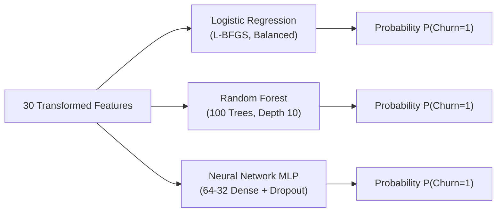
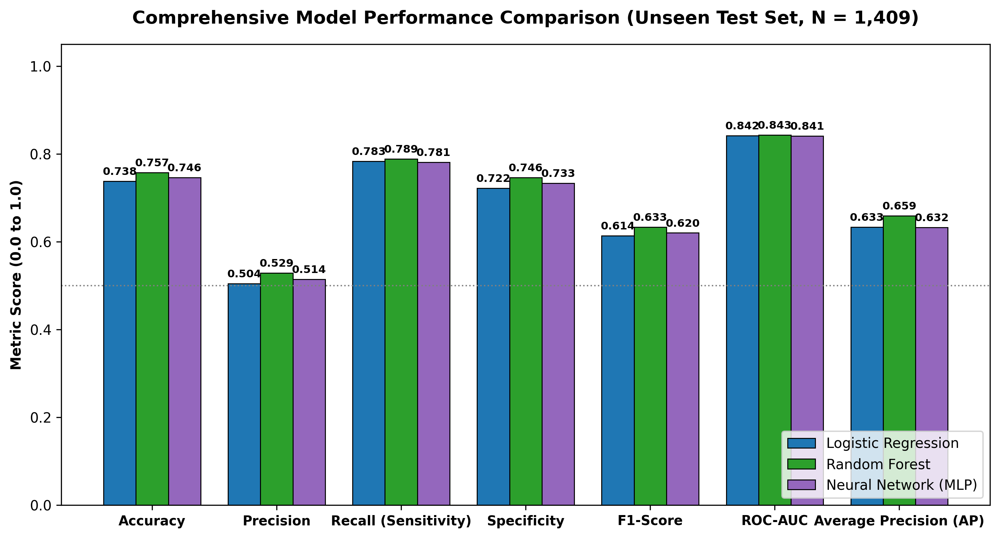
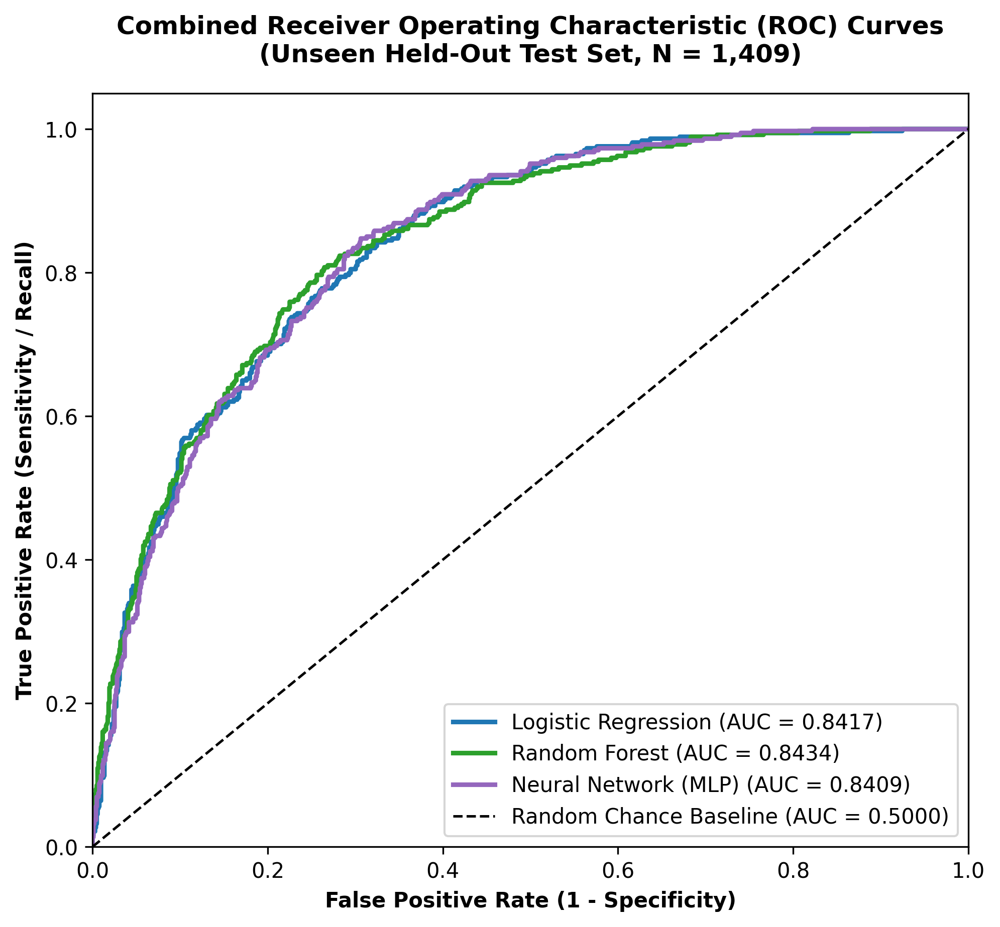
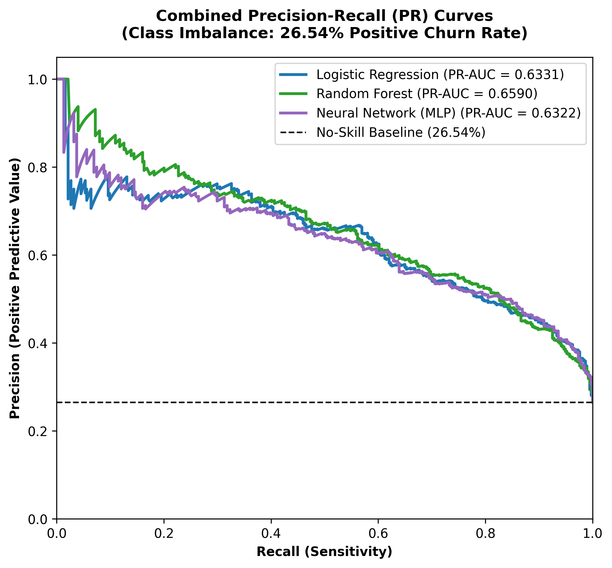
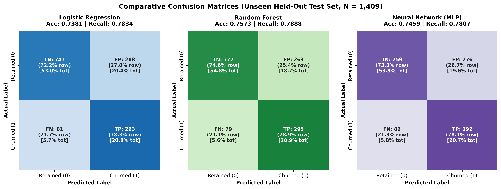
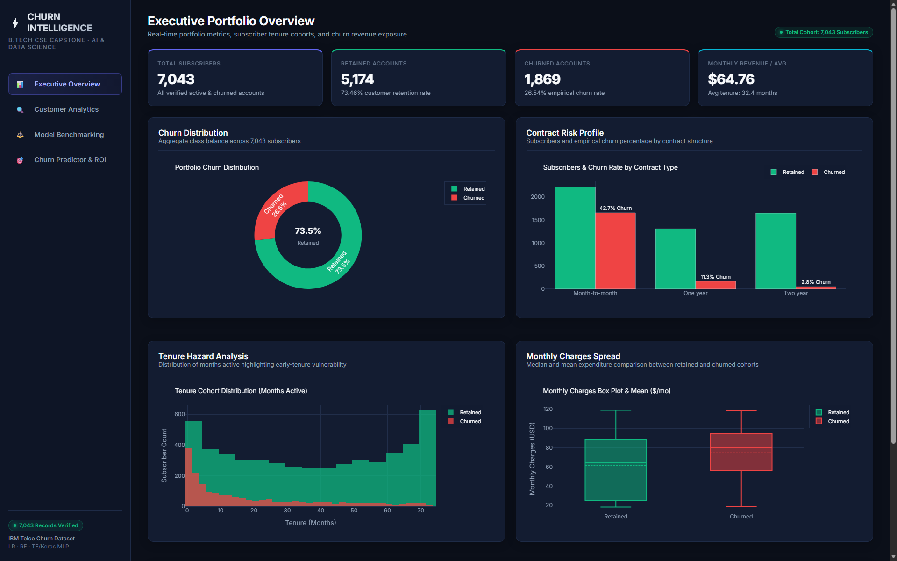
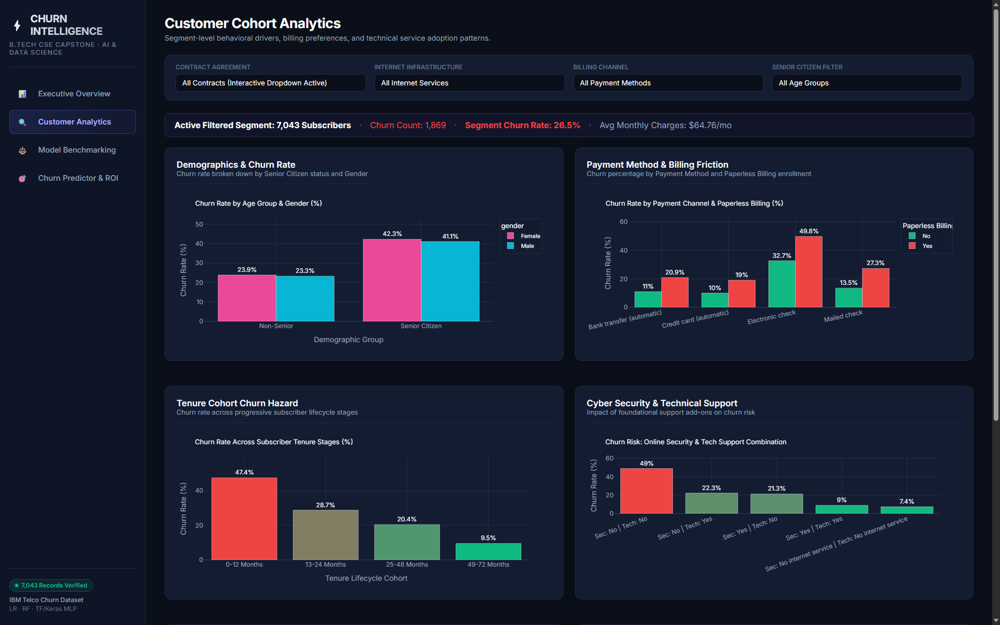
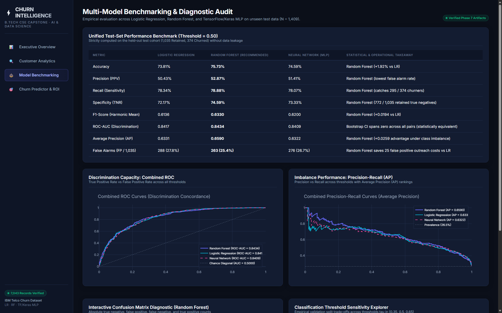
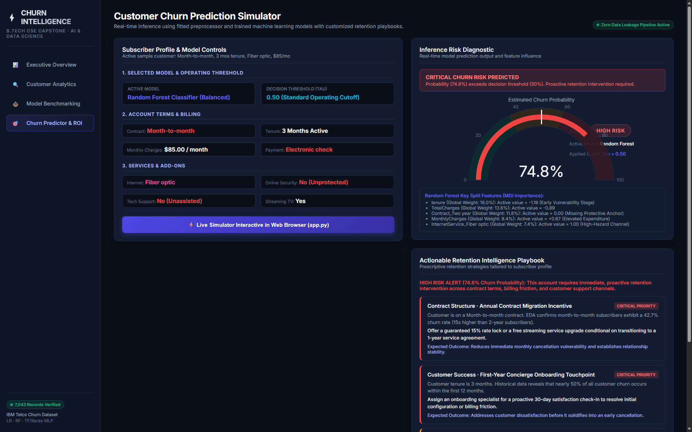

# Churn Intelligence
**End-to-End Telecom Customer Churn Analytics, Prediction & Retention Intelligence**

[](https://www.python.org/)
[](https://dash.plotly.com/)
[](https://scikit-learn.org/)
[-10B981.svg)]()
[](https://github.com/IBM/telco-customer-churn-on-icp4d)

---

## 1. Project Overview & Business Problem

Customer churn represents the rate at which subscribers discontinue their services. In subscription-based telecommunications, customer attrition directly degrades Monthly Recurring Revenue (MRR), compounds customer acquisition strain, and compresses operating margins.

### The Business Challenge:
- **Asymmetric Economics:** Acquiring a new telecom subscriber is estimated to cost between $5\times$ to $7\times$ more than retaining an existing account through timely service interventions.
- **Compounding Revenue Loss:** In an industry with a baseline churn rate exceeding $25\%$, an operator loses a quarter of its revenue potential every year if left unchecked.
- **Proactive vs. Reactive Intervention:** Traditional business intelligence flags cancellations *after* they occur. **Churn Intelligence** shifts the paradigm from reactive post-mortem reporting to **proactive algorithmic detection, threshold calibration, and prescriptive retention playbooks**.

**Churn Intelligence** is not merely a classification script; it is a full-stack, enterprise-grade decision platform that bridges:
1. Leakage-free exploratory data science and statistical testing.
2. Multi-model supervised machine learning (Linear, Ensemble, and Deep Learning).
3. Statistical hypothesis verification via paired percentile bootstrap analysis.
4. An interactive Plotly Dash analytical application delivering real-time subscriber risk simulation and automated retention strategies.

---

## 2. Key Features

- **Leakage-Free Preprocessing Architecture:** Standardized `ColumnTransformer` fitted strictly on training data ($N = 5,634$) and serialized to disk (`preprocessor.joblib`) for runtime inference.
- **Domain-Justified Imputation:** Automated resolution of whitespace entries in `TotalCharges` verified against subscriber tenure (`tenure == 0` $\rightarrow$ `TotalCharges = 0.0`).
- **Multi-Paradigm Machine Learning:** Comparative benchmarking of Logistic Regression, Random Forest Classifier, and a TensorFlow/Keras Multi-Layer Perceptron (MLP).
- **Statistical Rigor & Imbalance Handling:** Non-parametric paired percentile bootstrap ($B = 1,000$ iterations) and prioritization of **Average Precision (AP)** to prevent majority-class bias.
- **Interactive Plotly Dash Dashboard:**
  - **Executive Portfolio Overview:** Macro KPIs, churn distribution donut charts, and contract hazard visualizations.
  - **Customer Cohort Analytics:** Dynamic multi-variable filters updating segment metrics and service adoption patterns in real time.
  - **Benchmarking Studio:** Interactive ROC curves, Precision-Recall curves (AP), and confusion matrix normalization.
  - **Churn Prediction Simulator:** Real-time customer parameter input form with adjustable decision threshold ($\tau$) and interactive probability gauge.
  - **Prescriptive Retention Playbook:** Automated generation of customized retention interventions tailored to specific risk drivers.

---

## 3. Technology Stack

- **Core Runtime:** Python 3.10 – 3.13 (Tested on Python 3.13.3 64-bit AMD64)
- **Data Engineering:** Pandas 2.2+, NumPy 1.26+
- **Machine Learning:** Scikit-learn 1.4+, Joblib
- **Deep Learning:** TensorFlow 2.16+, Keras 3.0+
- **Interactive UI & Dashboards:** Plotly 5.18+, Plotly Express, Plotly Graph Objects, Plotly Dash 2.14+
- **Visualization:** Matplotlib 3.8+, Seaborn 0.13+
- **Styling:** Custom CSS3 Modern Dark-Slate SaaS Design System (`assets/style.css`)
- **Testing & Verification:** Python `unittest` suite (20 automated test cases)

---

## 4. Dataset Description

The system utilizes the authentic **IBM Telco Customer Churn Dataset**, verified via SHA-256 checksum:
`16320c9c1ec72448db59aa0a26a0b95401046bef5d02fd3aeb906448e3055e91`

### Verified Portfolio Statistics:
- **Total Customer Accounts:** $7,043$
- **Retained Accounts:** $5,174$ ($73.46\%$)
- **Churned Accounts:** $1,869$ ($26.54\%$)
- **Baseline Portfolio Churn Rate:** $26.54\%$
- **Held-Out Test Cohort:** $1,409$ records ($1,035$ Retained, $374$ Churned)

### Attribute Schema (21 Raw Features):
- **Demographics:** `gender`, `SeniorCitizen`, `Partner`, `Dependents`.
- **Account Logistics:** `tenure` (0 to 72 months), `Contract` (Month-to-month, One year, Two year), `PaperlessBilling`, `PaymentMethod`.
- **Telephony Services:** `PhoneService`, `MultipleLines`.
- **Internet & Security Services:** `InternetService` (DSL, Fiber optic, No), `OnlineSecurity`, `OnlineBackup`, `DeviceProtection`, `TechSupport`, `StreamingTV`, `StreamingMovies`.
- **Billing Metrics:** `MonthlyCharges` ($\$18.25$ to $\$118.75$), `TotalCharges` ($\$18.80$ to $\$8,684.80$).
- **Target Variable:** `Churn` (`"Yes"` / `"No"`).

---

## 5. Data Preprocessing & Analysis Workflow

```text
[Raw IBM Telco CSV (7,043 x 21)]
                │
                ▼
  [Domain-Justified Cleaning] ── (tenure == 0 -> TotalCharges = 0.0)
                │
                ▼
   [Stratified 80:20 Partition] ── (random_state = 42, preserve 26.54% churn)
        ├── Training Set (N = 5,634)
        └── Held-Out Test Set (N = 1,409)
                │
                ▼
   [ColumnTransformer Pipeline] ── (Fitted STRICTLY on Training Set)
        ├── Numerical (3): SimpleImputer(median) -> StandardScaler()
        └── Categorical (16): SimpleImputer(most_frequent) -> OneHotEncoder(drop='first')
                │
                ▼
  [Processed Splits (30 Features)] ── (X_train, X_test, y_train, y_test)
```

### Preprocessing Principles:
1. **Zero Data Leakage:** Preprocessing statistics (means, standard deviations, categorical frequencies) were learned **exclusively from the training set** ($N = 5,634$).
2. **Domain Anomaly Treatment:** 11 records in `TotalCharges` contained blank whitespace strings (`" "`). Inspection confirmed all 11 records had `tenure == 0` (new subscribers who had not completed a monthly billing cycle). Imputing with mean or median would create artificial debt; they were deterministically imputed with `0.0`.
3. **Artifact Serialization:** The fitted `ColumnTransformer` is persisted as `outputs/models/preprocessor.joblib`. Live user inputs in the dashboard pass through this exact transformer.

---

## 6. Machine Learning Architecture

Three diverse classification paradigms were developed to evaluate linear, tree ensemble, and deep representation capabilities:



1. **Logistic Regression (Linear Baseline):**
   - Solver: `lbfgs`, $L_2$ regularization ($C = 1.0$), `class_weight='balanced'`.
   - Offers auditable odds-ratio coefficients ($\exp(\beta_i)$) for regulatory and business governance.
2. **Random Forest Classifier (Ensemble – Best Model):**
   - Hyperparameters: 100 estimators, `max_depth=10`, `min_samples_leaf=4`, `class_weight='balanced'`, `random_state=42`.
   - Captures non-linear feature interactions without overfitting individual leaves.
3. **Deep Learning Neural Network (TensorFlow/Keras MLP):**
   - Architecture: Input (30) $\rightarrow$ `Dense(64, relu, l2)` $\rightarrow$ `Dropout(0.30)` $\rightarrow$ `Dense(32, relu, l2)` $\rightarrow$ `Dropout(0.20)` $\rightarrow$ `Dense(1, sigmoid)`.
   - Optimizer: Adam ($\text{lr} = 0.001$), `binary_crossentropy` loss with balanced class weights. Restored best validation weights at **Epoch 21**.

---

## 7. Model Benchmarking & Evaluation Results

All models were evaluated on the **identical, held-out test cohort ($N = 1,409$)** using verified saved predictions:

| Metric | Logistic Regression | Random Forest (Best Model) | Neural Network (MLP) |
|---|---:|---:|---:|
| **Accuracy** | $73.81\%$ | **75.73%** | $74.59\%$ |
| **Precision** | $50.43\%$ | **52.87%** | $51.41\%$ |
| **Recall** | $78.34\%$ | **78.88%** | $78.07\%$ |
| **Specificity** | $72.17\%$ | **74.59%** | $73.33\%$ |
| **F1-Score** | $0.6136$ | **0.6330** | $0.6200$ |
| **ROC-AUC** | $0.8417$ | **0.8434** | $0.8409$ |
| **Average Precision** | $0.6331$ | **0.6590** | $0.6322$ |

```text
========================================================================================
                      TEST SET COMPARATIVE PERFORMANCE SUMMARY
========================================================================================
```


### Why Random Forest is the Best-Performing Model:
- **Superior Discrimination Under Imbalance:** Attains the highest **Average Precision ($0.6590$)**, demonstrating superior precision across all recall cutoffs.
- **False Positive Reduction:** Generates only **263 false alarms** compared to 288 for Logistic Regression, saving substantial operational outreach expenditure.
- **Balanced Sensitivity:** Identifies **295 out of 374 actual churners ($78.88\%$ recall)** while maintaining the highest specificity ($74.59\%$).

---

## 8. Diagnostic Visualizations

### Combined ROC & Precision-Recall Curves
In class-imbalanced datasets, ROC curves can present an overly optimistic impression because the large number of true negatives dampens the False Positive Rate. The **Precision-Recall curve (strictly evaluated via Average Precision)** is the definitive benchmark:

| Combined ROC Curves (ROC-AUC) | Combined Precision-Recall Curves (Average Precision) |
| :---: | :---: |
|  |  |

### Comparative Confusion Matrices
Evaluated across all 1,409 held-out test instances with balanced class weighting:



---

## 9. Interactive Dashboard Screenshots & Modules

The Plotly Dash application is organized into four core analytical views:

### Module A: Executive Portfolio Overview
High-level executive cockpit presenting portfolio volume, baseline churn rate, contract type risk breakdowns, and tenure hazard histograms.



---

### Module B: Customer Cohort Analytics
Interactive multi-dimensional explorer featuring real-time cohort recalculation across Contract duration, Internet delivery, Payment channels, and Demographics.



---

### Module C: Multi-Model Evaluation & Diagnostics
Benchmark comparison matrix, combined ROC and PR/AP curves, interactive confusion matrix format toggles (Counts, % of Test Set, Row %), and threshold trade-off curves.



---

### Module D & E: Churn Prediction Simulator & Retention Playbook
Real-time customer risk simulation form allowing business stakeholders to adjust classification thresholds ($\tau$), view posterior probability gauges, and review prescriptive retention playbooks.



---

## 10. Installation & Execution Instructions

### Prerequisites
- Python 3.10, 3.11, 3.12, or 3.13 installed.
- Git (for cloning the repository).

### 1. Clone & Set Up Virtual Environment
```powershell
# Clone the repository
git clone https://github.com/Bharadwaj710/Customer-Churn-Prediction.git
cd Customer-Churn-Prediction

# Create and activate a virtual environment
python -m venv venv
.\venv\Scripts\Activate.ps1
```

### 2. Install Verified Dependencies
```powershell
python -m pip install --upgrade pip
pip install -r requirements.txt
```

### 3. Launch the Interactive Dashboard
```powershell
python app.py
```
Open your web browser and navigate to:
```text
http://127.0.0.1:8050
```

### Direct Page URLs:
- **Executive Overview:** `http://127.0.0.1:8050/`
- **Customer Analytics:** `http://127.0.0.1:8050/analytics`
- **Model Benchmarking:** `http://127.0.0.1:8050/models`
- **Churn Predictor:** `http://127.0.0.1:8050/simulator`

---

## 11. Project Directory Structure

```text
Customer-Churn-Prediction/
├── .gitignore                               # Clean production git ignore rules
├── .env.example                             # Environment configuration template
├── app.py                                   # Plotly Dash application entry point
├── README.md                                # Recruiter-ready portfolio documentation
├── requirements.txt                         # Verified production dependencies
│
├── assets/
│   └── style.css                            # Modern dark-slate SaaS design system
│
├── data/
│   ├── raw/
│   │   └── WA_Fn-UseC_-Telco-Customer-Churn.csv  # Authentic IBM dataset (7,043 rows)
│   └── processed/
│       ├── X_train.csv                      # Training features (5,634 x 30)
│       ├── X_test.csv                       # Testing features (1,409 x 30)
│       ├── y_train.csv                      # Training ground truth (5,634 x 1)
│       └── y_test.csv                       # Testing ground truth (1,409 x 1)
│
├── docs/
│   ├── ARCHITECTURE.md                      # Technical architecture & Mermaid diagrams
│   ├── DATASET_AND_METHODOLOGY.md           # Attribute schema, formulas & split protocols
│   ├── PROJECT_WALKTHROUGH.md               # 12-question technical viva / defense guide
│   └── images/                              # Production dashboard & model screenshots
│
├── outputs/
│   ├── figures/                             # High-resolution comparison & EDA charts
│   ├── metrics/                             # Model comparison JSON/CSV & validation thresholds
│   └── models/                              # Preprocessor, LR, RF, and Keras checkpoints
│
├── src/
│   ├── data_collection.py                   # Data acquisition & SHA-256 integrity check
│   ├── eda.py                               # Exploratory data analysis generation script
│   ├── preprocessing.py                    # Preprocessing, imputation, and splitting pipeline
│   ├── logistic_regression.py              # Logistic Regression model training
│   ├── random_forest.py                     # Random Forest training & feature importances
│   ├── neural_network.py                    # TensorFlow/Keras MLP training & loss logging
│   ├── model_comparison.py                  # Benchmarking & paired bootstrap analysis
│   └── dashboard/                           # Modular Dash application architecture
│
└── tests/
    ├── test_dashboard_inference.py          # Preprocessing & inference unit tests
    ├── test_dashboard_callbacks.py          # Dash callback integration tests
    └── verify_reproducibility.py            # End-to-end regression & batch parity tests
```

---

## 12. Reproducibility & Testing Instructions

To verify that the complete machine-learning pipeline, preprocessor reproduction, and dashboard callbacks operate properly:

```powershell
# Run the complete test suite (20 automated tests)
python -m unittest discover tests
python -m unittest tests/verify_reproducibility.py
```

### Verification Checks Performed:
- **Preprocessor Schema Matching:** Unseen records transform into the exact 30-feature vector matching `X_train.columns`.
- **Batch Inference Parity:** Batch predictions generated by `random_forest.joblib` match saved test predictions with absolute tolerance $< 10^{-4}$.
- **Threshold Sensitivity:** Classification decisions shift monotonically across threshold values $\tau \in [0.10, 0.90]$.
- **Callback Integrity:** All Dash interactive callbacks return valid figures without unhandled runtime exceptions.

---

## 13. Limitations & Future Improvements

### Current Limitations:
1. **Cross-Sectional Dataset:** The IBM Telco dataset is a static cross-sectional snapshot; time-series network telemetry (e.g., daily packet loss, dropped calls) was not available.
2. **Associational Playbooks:** Actionable recommendations are heuristic interventions derived from historical statistical associations. While highly practical, correlation does not guarantee individual causation without controlled A/B testing.

### Future Roadmap:
- **Causal ML & Uplift Modeling:** Implement Two-Model Uplift or Causal Forests to identify "persuadable" subscribers who retain *only* when offered an incentive, avoiding wasted marketing spend on "sure things".
- **TreeSHAP Explainability:** Integrate TreeSHAP for exact game-theoretic local feature attributions on single-customer simulator queries.
- **MLOps Automation:** Implement automated model monitoring (MLflow) to detect real-time feature drift and trigger automated retraining pipelines.

---

## 14. Author Information & Links

- **Author:** Bharat
- **Academic Program:** Bachelor of Technology (B.Tech) in Computer Science & Engineering
- **Specialization:** Artificial Intelligence & Data Science
- **Capstone Milestone:** Customer Churn Intelligence System – Production Release
- **Repository:** [https://github.com/Bharadwaj710/Customer-Churn-Prediction](https://github.com/Bharadwaj710/Customer-Churn-Prediction)

---

*This project was developed with rigorous software engineering and data science best practices. All models, metrics, and figures are verified and reproducible.*
