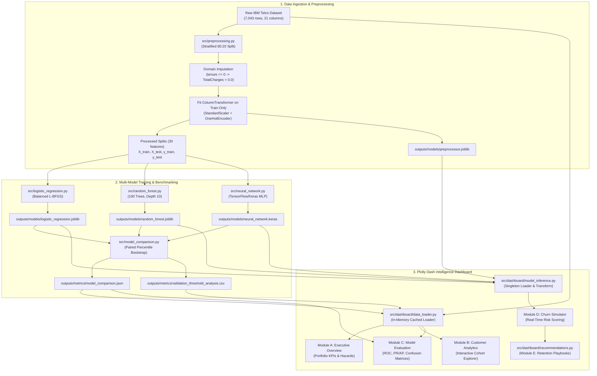
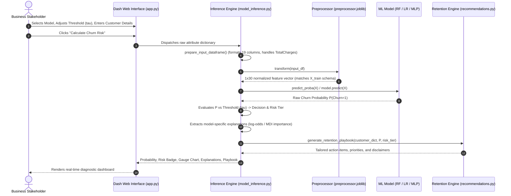

# System Architecture Documentation

## Customer Churn Intelligence System

This document outlines the end-to-end software and data science architecture of the **Customer Churn Prediction and Intelligence System**. The platform is engineered to bridge exploratory data science, leakage-free machine-learning pipelines, multi-model empirical benchmarking, and an interactive Plotly Dash analytical application.

---

## 1. High-Level System Architecture

The system is partitioned into three major functional tiers:
1. **Offline Pipeline Tier (Data Ingestion, Preprocessing & Modeling):** Ingests authentic IBM Telco data, applies domain-justified transformations strictly on training splits, trains three diverse classification paradigms, and serializes fitted pipelines and prediction logs.
2. **Persistence & Serialization Tier (Artifact Storage):** Houses versioned model checkpoints (`.joblib`, `.keras`), pre-computed test set predictions, and verified evaluation metrics.
3. **Interactive Application Tier (Plotly Dash & Business Intelligence):** Provides an asynchronous web application featuring dynamic filtering, comparative model diagnostics, real-time subscriber risk simulation, and automated prescriptive retention playbooks.

---

## 2. Data Lifecycle and Transformation Flow

To guarantee strict academic reproducibility and **zero data leakage**, feature transformers are fit exclusively on the training partition ($N = 5,634$) and subsequently applied to test data ($N = 1,409$) and live inference inputs.

### Preprocessing Specifications
- **Input Dimensions:** 21 raw columns (1 unique ID dropped, 1 target separated, 19 predictive attributes).
- **Domain Anomaly Treatment:** 11 records with whitespace strings in `TotalCharges` all had `tenure == 0`. These represent newly onboarded subscribers prior to initial billing generation. They are deterministically imputed with `0.0`.
- **Target Encoding:** Binary mapping (`No` $\rightarrow 0$, `Yes` $\rightarrow 1$).
- **Partitioning:** Stratified 80:20 split (`random_state=42`), preserving the empirical $73.46\%$ / $26.54\%$ class balance.
- **Continuous Features (3):** `tenure`, `MonthlyCharges`, `TotalCharges` processed via `StandardScaler()`.
- **Categorical Features (16):** Processed via `OneHotEncoder(drop='first', sparse_output=False, handle_unknown='ignore')`.
- **Output Dimensionality:** Exactly 30 numerical features.

---

## 3. Real-Time Inference & Simulation Flow

When a user submits a customer profile through the interactive dashboard (or calls the inference API), the request follows an isolated execution path:

---

## 4. Dash Application Modularization

The Plotly Dash dashboard is decomposed into modular packages within `src/dashboard/`:

1. **`config.py`**: Houses application-wide constants, file path bindings, semantic color tokens (`#EF4444` churn, `#10B981` retained, `#F59E0B` moderate risk), and shared Plotly layout dictionaries.
2. **`data_loader.py`**: Manages cached I/O operations for raw datasets, held-out test predictions, and pre-computed evaluation summaries. Uses in-memory caching to eliminate disk overhead during UI interactions.
3. **`model_inference.py`**: Singleton model manager. Loads the Scikit-learn preprocessor, Logistic Regression, Random Forest, and TensorFlow MLP into memory once at startup. Converts raw parameter dictionaries into valid 30-feature vectors.
4. **`recommendations.py`**: Domain intelligence engine that translates statistical risk factors into four operational retention strategies (Contract Upgrade, Onboarding Concierge, Premium Support Bundling, and Autopay Incentives).
5. **`components/`**:
   - `navbar.py`: Persistent sidebar navigation with live record verification badges.
   - `cards.py`: Standardized card containers, KPI statistic blocks, and interactive Plotly gauge charts.
6. **`tabs/`**:
   - `executive_overview.py`: Module A landing page with high-level KPIs, churn donut, contract risk profiles, and tenure hazard histograms.
   - `customer_analytics.py`: Module B interactive cohort explorer with cross-filtering across contracts, internet types, billing methods, and demographics.
   - `model_evaluation.py`: Module C unified benchmark matrix, combined ROC curves, combined Precision-Recall curves (labeled Average Precision), confusion matrix explorer, and threshold trade-offs.
   - `churn_simulator.py`: Modules D & E interactive subscriber form, real-time risk scoring, feature influence breakdown, and prescriptive retention playbook.
7. **`assets/style.css`**: Professional dark-slate SaaS design system with custom typography, responsive card layouts, and risk badges.

---

## 5. Model Inference Verification & Reproducibility

To ensure cross-platform compatibility and zero data leakage:
- Preprocessor input requirements are strictly validated against `X_train.columns`.
- TensorFlow CPU execution is enforced with `TF_ENABLE_ONEDNN_OPTS=0` and `TF_CPP_MIN_LOG_LEVEL=3` to ensure deterministic floating-point consistency across operating systems.
- Every model output is verifiable via automated unit tests in `tests/test_dashboard_inference.py` and callback tests in `tests/test_dashboard_callbacks.py`.

