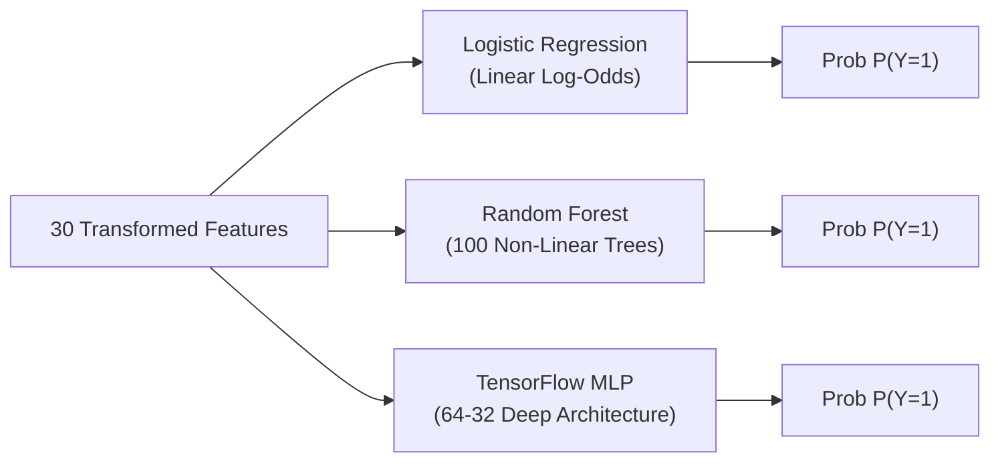

# Dataset and Methodology Documentation

## Customer Churn Prediction – Capstone Methodology

This document provides a comprehensive technical reference for the dataset provenance, exploratory data analysis, preprocessing protocols, model training specifications, and empirical evaluation methodology utilized in this project.

---

## 1. Dataset Origin & Provenance

- **Dataset Name:** IBM Telco Customer Churn Dataset
- **Original Source:** [IBM Developer Community Repository](https://raw.githubusercontent.com/IBM/telco-customer-churn-on-icp4d/master/data/Telco-Customer-Churn.csv)
- **Local Location:** `data/raw/WA_Fn-UseC_-Telco-Customer-Churn.csv`
- **Integrity Verification:** Authentic SHA-256 checksum:
  `16320c9c1ec72448db59aa0a26a0b95401046bef5d02fd3aeb906448e3055e91`
- **Dataset Dimensions:** 7,043 instances (rows) and 21 attributes (columns).
- **Target Variable:** `Churn` (Binary categorical string: `"Yes"` vs. `"No"`).

### Attribute Dictionary & Descriptive Summary

| Attribute | Data Type | Value Range / Categories | Description |
| :--- | :--- | :--- | :--- |
| `customerID` | Object (String) | 7,043 unique alphanumeric strings | Primary account identifier (excluded from predictive features) |
| `gender` | Categorical | `Male`, `Female` | Subscriber biological sex |
| `SeniorCitizen` | Binary Integer | `0`, `1` | Indicator whether customer is 65 years or older |
| `Partner` | Categorical | `Yes`, `No` | Whether the customer has a domestic partner |
| `Dependents` | Categorical | `Yes`, `No` | Whether the customer has financial dependents |
| `tenure` | Continuous (Int) | `0` to `72` months | Total number of months account has remained active |
| `PhoneService` | Categorical | `Yes`, `No` | Whether subscriber has landline phone service |
| `MultipleLines` | Categorical | `No phone service`, `No`, `Yes` | Whether customer has multiple phone lines |
| `InternetService` | Categorical | `DSL`, `Fiber optic`, `No` | Primary internet delivery infrastructure |
| `OnlineSecurity` | Categorical | `No`, `Yes`, `No internet service` | Cyber security protection add-on |
| `OnlineBackup` | Categorical | `No`, `Yes`, `No internet service` | Cloud data backup add-on |
| `DeviceProtection` | Categorical | `No`, `Yes`, `No internet service` | Equipment warranty and damage insurance |
| `TechSupport` | Categorical | `No`, `Yes`, `No internet service` | Dedicated priority technical support tier |
| `StreamingTV` | Categorical | `No`, `Yes`, `No internet service` | Digital television streaming service |
| `StreamingMovies` | Categorical | `No`, `Yes`, `No internet service` | Premium on-demand movie streaming |
| `Contract` | Categorical | `Month-to-month`, `One year`, `Two year` | Active contractual commitment duration |
| `PaperlessBilling` | Categorical | `Yes`, `No` | Whether billing statements are electronic |
| `PaymentMethod` | Categorical | `Electronic check`, `Mailed check`, `Bank transfer (automatic)`, `Credit card (automatic)` | Primary billing payment channel |
| `MonthlyCharges` | Continuous (Float)| $\$18.25$ to $\$118.75$ | Current monthly subscription bill amount |
| `TotalCharges` | Continuous (Object)| $\$18.80$ to $\$8,684.80$ (11 blank records) | Cumulative billing charges accrued over account lifetime |
| `Churn` | Categorical (Target)| `No` (5,174), `Yes` (1,869) | Binary indicator of customer departure |

---

## 2. Data Cleaning & Preprocessing Protocol

### 2.1 Domain-Justified Missing Value Imputation
The raw dataset contains zero standard IEEE `NaN` values. However, an automated whitespace audit revealed **11 records** in `TotalCharges` containing blank whitespace strings (`" "`).
- **Domain Verification:** A cross-tabulation check confirmed that all 11 records possess `tenure == 0`.
- **Domain Rationale:** Subscribers with zero months of completed service have not accrued an initial monthly invoice. Imputing with mean or median would introduce artificial debt and distort the charges-to-tenure relationship.
- **Action:** These 11 records are deterministically imputed with `0.0`.

### 2.2 Target Encoding & Leakage-Free Stratified Split
- Target variable `Churn` is mapped to binary integer: `No` $\rightarrow 0$, `Yes` $\rightarrow 1$.
- `customerID` is dropped to prevent arbitrary identity memorization.
- The dataset ($N = 7,043$) is partitioned using an **80:20 stratified train/test split** with fixed seed (`random_state=42`):
  - **Training Set ($80\%$):** $N_{\text{train}} = 5,634$ samples ($4,139$ Retained, $1,495$ Churned; $26.54\%$ churn prevalence).
  - **Held-Out Test Set ($20\%$):** $N_{\text{test}} = 1,409$ samples ($1,035$ Retained, $374$ Churned; $26.54\%$ churn prevalence).

### 2.3 Feature Transformation Pipeline
A Scikit-learn `ColumnTransformer` is fitted **strictly on $X_{\text{train}}$**:
- **Continuous Scaler (3 features):** `tenure`, `MonthlyCharges`, `TotalCharges` normalized via `StandardScaler()`. Mean and variance parameters are learned solely from the training distribution.
- **Categorical Encoder (16 features):** Transformed via `OneHotEncoder(drop='first', sparse_output=False, handle_unknown='ignore')`. Dropping the first dummy level avoids multi-collinearity in linear models.
- **Output Matrix:** Yields an identical 30-feature schema across training, testing, and inference.

---

## 3. Machine Learning Modeling Specifications

Three distinct mathematical paradigms were implemented to assess linear, non-linear ensemble, and representation learning capabilities:

### 3.1 Model 1: Logistic Regression (Linear Baseline)
- **Library:** `sklearn.linear_model.LogisticRegression`
- **Solver:** `lbfgs`
- **Regularization:** $L_2$ penalty, $C = 1.0$
- **Class Balancing:** `class_weight='balanced'` (dynamically scales loss inversely proportional to class frequencies: $w_0 \approx 0.68$, $w_1 \approx 1.88$).
- **Maximum Iterations:** 1,000 (converged smoothly).
- **Core Role:** Fully interpretable baseline providing auditable odds-ratio coefficients ($\exp(\beta_i)$).

### 3.2 Model 2: Random Forest (Ensemble Classifier – Recommended)
- **Library:** `sklearn.ensemble.RandomForestClassifier`
- **Estimators:** 100 decision trees
- **Max Depth:** 10 levels
- **Min Samples Leaf:** 4 samples (prevents isolated leaf overfitting)
- **Class Balancing:** `class_weight='balanced'`
- **Random Seed:** `random_state=42`
- **Core Role:** Captures non-linear feature interactions (e.g., tenure $\times$ contract type) while mitigating individual tree variance through bootstrap aggregation and feature bagging.

### 3.3 Model 3: Deep Learning Neural Network (TensorFlow/Keras MLP)
- **Framework:** TensorFlow 2.16+ / Keras Sequential API
- **Architecture:**
  - Input Layer: 30 numerical input nodes.
  - Hidden Layer 1: `Dense(64, activation='relu', kernel_regularizer=l2(1e-4))`
  - Regularization: `Dropout(0.30)`
  - Hidden Layer 2: `Dense(32, activation='relu', kernel_regularizer=l2(1e-4))`
  - Regularization: `Dropout(0.20)`
  - Output Layer: `Dense(1, activation='sigmoid')`
- **Compilation:**
  - Optimizer: `Adam(learning_rate=0.001)`
  - Loss Function: `binary_crossentropy`
  - Class Weights: $\{0: 0.6806, 1: 1.8843\}$
- **Training Schedule:** Batch size 32, max 100 epochs, `EarlyStopping(patience=10, restore_best_weights=True)`. Early stopping restored the best validation loss weights at **Epoch 21**.

---

## 4. Empirical Evaluation Methodology & Rigor

### 4.1 Verified Benchmark Matrix on Held-Out Test Data ($N = 1,409$)

All metrics were computed strictly on the unseen held-out test cohort:

| Metric | Logistic Regression | Random Forest (Recommended) | Neural Network (MLP) | Evaluation Focus |
| :--- | :---: | :---: | :---: | :--- |
| **Accuracy** | $73.81\%$ | **75.73%** | $74.59\%$ | Overall correct classification rate |
| **Precision (PPV)** | $50.43\%$ | **52.87%** | $51.41\%$ | Positive predictive value (false alarm control) |
| **Recall (Sensitivity)** | $78.34\%$ | **78.88%** | $78.07\%$ | Proportion of actual churners identified |
| **Specificity (TNR)** | $72.17\%$ | **74.59%** | $73.33\%$ | Proportion of retained accounts correctly flagged |
| **F1-Score** | $0.6136$ | **0.6330** | $0.6200$ | Harmonic mean of precision and recall |
| **ROC-AUC** | $0.8417$ | **0.8434** | $0.8409$ | Discrimination ranking concordance |
| **Average Precision (AP)**| $0.6331$ | **0.6590** | $0.6322$ | Area under Precision-Recall curve |
| **False Positives (FP)** | 288 | **263** | 276 | Operational outreach false alarms |
| **False Negatives (FN)** | 81 | **79** | 82 | Missed churners |

### 4.2 Importance of Average Precision (AP) Under Class Imbalance
In tabular churn forecasting ($26.54\%$ prevalence), **ROC-AUC can present an overly optimistic impression of performance** because the False Positive Rate denominator includes all 1,035 retained subscribers. 
- **Average Precision (AP)** directly tracks the precision-recall trade-off across operating thresholds:
  $$\text{AP} = \sum_n (R_n - R_{n-1}) P_n$$
- Random Forest attains an $\text{AP} = 0.6590$ (a $+0.0259$ advantage over Logistic Regression and $+0.0268$ over the Neural Network), confirming superior prioritization of at-risk subscribers.

### 4.3 Paired Bootstrap Resampling Audit
To determine if observed metric differences reflect statistical superiority:
- A non-parametric **paired percentile bootstrap** was executed with $B = 1,000$ iterations (`random_state=42`) using shared sample indices across models.
- **Finding:** The $95\%$ empirical confidence interval for the difference in ROC-AUC between Random Forest and Logistic Regression spanned zero: $[-0.0021, +0.0079]$.
- **Conclusion:** While Random Forest achieves the highest point estimates in accuracy, precision, and AP, the three paradigms possess statistically comparable global discriminative capacity.

### 4.4 Validation Threshold Sensitivity Analysis
To avoid test set data leakage, classification decision thresholds $\tau \in \{0.35, 0.50, 0.65\}$ were benchmarked on the independent validation split ($N = 1,127$):

| Model | Threshold $\tau$ | Accuracy | Precision | Recall | Specificity | F1-Score |
| :--- | :---: | :---: | :---: | :---: | :---: | :---: |
| **Random Forest** | $0.35$ | $71.34\%$ | $47.66\%$ | $96.61\%$ | $62.38\%$ | $0.6383$ |
| **Random Forest** | $0.50$ | $78.44\%$ | $55.58\%$ | $87.80\%$ | $75.12\%$ | $0.6807$ |
| **Random Forest** | $0.65$ | $83.41\%$ | $68.49\%$ | $67.80\%$ | $88.94\%$ | $0.6814$ |

*Operational Insight:* Lowering the threshold to $\tau = 0.35$ captures $> 96\%$ of churners (ideal for low-cost digital retention nudges), whereas raising it to $\tau = 0.65$ increases precision to $68.5\%$ (ideal for high-cost VIP retention offers).

---

## 5. Methodological Limitations

1. **Cross-Sectional Observational Nature:** The IBM Telco dataset represents a point-in-time snapshot without longitudinal monthly event timestamps. Temporal causality cannot be definitively proven.
2. **Tabular Inductive Biases:** Neural networks on tabular data lack spatial or temporal inductive biases, requiring careful regularizing (Dropout, $L_2$). Random Forest's axis-aligned splits proved naturally suited for tabular feature interactions.
3. **Generalization Gap Context:** Random Forest exhibited an expected delta between training ($81.26\%$ accuracy) and testing ($75.73\%$ accuracy). Because it attained the highest unseen test score among all models, this delta reflects standard tree capacity rather than pathological failure.

